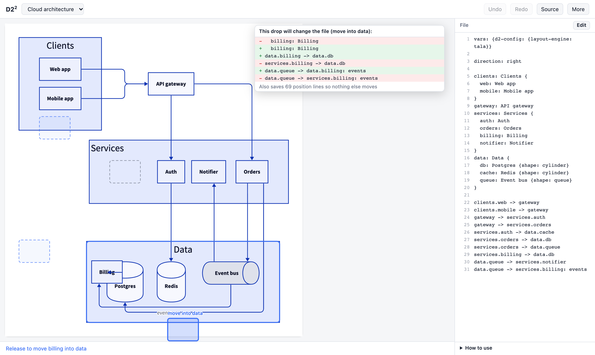

# D2²

D2² (D2 squared) lets you fix a [D2](https://d2lang.com) diagram by dragging. Move a box into a group, drag the end of an arrow onto another box, or place a box where you want it. Each drag becomes a small edit to your `.d2` file, so the file stays the source of truth. The site has examples you can drag, for example an org chart where you give someone a new manager.



## Try it

- Open the site: https://h0rv.github.io/d2-squared/. Nothing to install. It runs in your browser.
- Or edit a file on your machine:

```sh
go install github.com/h0rv/d2-squared/engine/cmd/d2squared@latest
d2squared serve diagram.d2
```

Then open http://127.0.0.1:8768. Drags are written to `diagram.d2`, and changes you make in your editor appear in the page.

## How it works

When you start a drag, D2² works out the edits that drag could make and lays out the result of each one. Drop zones appear where the dragged box would land. The panel shows the lines that would change. The layout you preview is the layout that is saved.

Work is split into steps so the drag never waits.

| Step | What it does | When |
|---|---|---|
| Move | Moves the dragged shape | Every frame |
| Route | Redraws the arrows that touch it | While dragging |
| Candidates | Lays out each possible result | From pointer down, nearest first |
| Full layout | Lays out everything again | First open, reset, edits from outside |

Boxes you did not touch keep their place. D2² saves their positions as `top` and `left` in the file, so a fresh layout matches what you saw. See [docs/DESIGN.md](docs/DESIGN.md) for details.

## Relation to Declarative Dragging

The idea comes from the paper [Declarative Dragging](https://declarative-dragging.github.io/) (Horowitz, Blinn, Heer, UIST 2026). You list the states a drag can lead to, draw each one, and build the drop zones from where the dragged item lands. Its library, dragology, is written for React and needs each state to render in the same frame. D2 layouts take tens to hundreds of milliseconds, so D2² has its own small drag loop. It picks the closest drop zone and shows a floating copy of the dragged shape while layouts arrive in the background.

## Limits

- The in-browser engine is about 4 times slower than the native one, and it downloads about 9 MB once.
- Large diagrams are slow in the browser. See the timings below. Use `d2squared serve` for those.
- The first edit saves a position for every box, so the file gets longer. Reset positions removes them.
- You can drop a box only onto a group. A plain box can not hold other boxes.

Timings in the browser engine, in headless Chrome on a 10 core Mac:

| Diagram | First load | First zone | All zones | Drop to new view |
|---|---|---|---|---|
| Cloud architecture (12 boxes) | 0.8 s | 0.2 s | 0.2 s | 0.15 s |
| Shop database (8 tables) | 0.7 s | 0.1 s | 0.2 s | under 0.01 s |
| Large database (36 tables, not in the picker) | 0.7 s, then 6 s to lay out | 1.3 s | 14 s | 0.04 s |

First load is from a local static server, so it does not include the 9 MB download. A zone is a drop target whose exact result has arrived. Zones appear as dashed outlines at once and become exact as layouts finish. The drop is quick because the engine builds the zone you are over while you drag.

## Develop

You need Go and Node.js.

```sh
make ui      # build the web UI that d2squared embeds
make test    # Go tests, lint, typecheck and the Playwright tests
```

The Go engine is in `engine/` and the web app is in `web/`. `npm run build` in `web/` builds the WebAssembly engine and the site.

## Credits

- [D2](https://d2lang.com) by Terrastruct and Hack Club, and its TALA layout engine.
- [Declarative Dragging](https://declarative-dragging.github.io/) and dragology, by Horowitz, Blinn and Heer.

## License

[MPL-2.0](LICENSE), the same license as D2.
